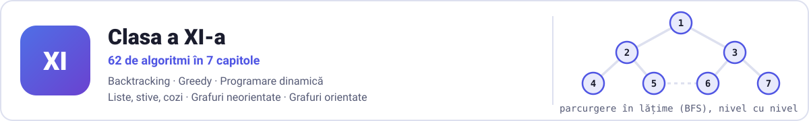

<p align="center"><a href="https://andrasbogdanandrei.github.io/Algoritmi-Elementari-CodePrepper/"><picture><source media="(prefers-color-scheme: dark)" srcset=".github/assets/banner-dark.svg"></picture></a></p>

# Algoritmi elementari în C++ — probleme rezolvate pentru liceu și bacalaureat

**266 de algoritmi elementari în C++, explicați și verificați**, pentru informatica de liceu
(clasele IX–XII) și bacalaureat: cifre, vectori, sortări, backtracking, greedy, programare dinamică, grafuri și altele.

[](https://github.com/AndrasBogdanAndrei/Algoritmi-Elementari-CodePrepper/actions/workflows/verificare.yml)
[](LICENSE)
[](#cuprins)
[](#cum-folosești-algoritmii)
[](https://github.com/AndrasBogdanAndrei/Algoritmi-Elementari-CodePrepper/stargazers)

**[Pagina proiectului](https://andrasbogdanandrei.github.io/Algoritmi-Elementari-CodePrepper/)** · **[Aplicația CodePrepper](https://github.com/AndrasBogdanAndrei/CodePrepper)** ·
[Cuprins](#cuprins) · [Cum folosești](#cum-folosești-algoritmii) · [Întrebări frecvente](#întrebări-frecvente)

Colecția este organizată după programa școlară de la profilul matematică-informatică, în
27 de capitole. Fiecare program are la început o explicație a ideii, complexitatea și cel
puțin un exemplu de intrare și ieșire. Toate programele sunt verificate automat: se compilează fără avertismente și dau
exact rezultatul din exemplu, pe Windows, Linux și macOS.

> Vrei să vezi algoritmii animați pas cu pas, să rezolvi probleme cu evaluare automată și să dai teste grilă?
> Încearcă aplicația gratuită **[CodePrepper](https://github.com/AndrasBogdanAndrei/CodePrepper)** ([pagina aplicației](https://andrasbogdanandrei.github.io/CodePrepper/)).


<p align="center"><picture><source media="(prefers-color-scheme: dark)" srcset=".github/assets/separator-dark.svg"></picture></p>

## Cuprins

- [Cum folosești algoritmii](#cum-folosești-algoritmii)
- [Cei mai căutați algoritmi](#cei-mai-căutați-algoritmi)
- **[Clasa a IX-a](#clasa-a-ix-a)** — 87 de algoritmi, 8 capitole
  - [Cifrele unui număr](#cifrele-unui-număr) (15)
  - [Divizibilitate și numere prime](#divizibilitate-și-numere-prime) (17)
  - [Șiruri de numere citite pe rând](#șiruri-de-numere-citite-pe-rând) (13)
  - [Baze de numerație](#baze-de-numerație) (6)
  - [Tablouri unidimensionale (vectori)](#tablouri-unidimensionale-vectori) (11)
  - [Sortare și căutare](#sortare-și-căutare) (10)
  - [Frecvență, sume parțiale și ciurul lui Eratostene](#frecvență-sume-parțiale-și-ciurul-lui-eratostene) (10)
  - [Fișiere text](#fișiere-text) (5)
- **[Clasa a X-a](#clasa-a-x-a)** — 67 de algoritmi, 6 capitole
  - [Subprograme (funcții)](#subprograme-funcții) (11)
  - [Tablouri bidimensionale (matrice)](#tablouri-bidimensionale-matrice) (15)
  - [Șiruri de caractere](#șiruri-de-caractere) (16)
  - [Tipul struct](#tipul-struct) (5)
  - [Recursivitate](#recursivitate) (12)
  - [Divide et impera](#divide-et-impera) (8)
- **[Clasa a XI-a](#clasa-a-xi-a)** — 62 de algoritmi, 7 capitole
  - [Metoda backtracking](#metoda-backtracking) (12)
  - [Metoda greedy](#metoda-greedy) (6)
  - [Programare dinamică](#programare-dinamică) (10)
  - [Alocare dinamică: liste, stive, cozi](#alocare-dinamică-liste-stive-cozi) (10)
  - [Grafuri neorientate](#grafuri-neorientate) (10)
  - [Grafuri orientate și drumuri minime](#grafuri-orientate-și-drumuri-minime) (6)
  - [Arbori](#arbori) (8)
- **[Clasa a XII-a](#clasa-a-xii-a)** — 50 de algoritmi, 6 capitole
  - [Numere mari](#numere-mari) (9)
  - [Algoritmi pe grile: Lee și fill](#algoritmi-pe-grile-lee-și-fill) (6)
  - [Matematică pentru programare](#matematică-pentru-programare) (9)
  - [Tehnici avansate: doi pointeri, căutare binară pe răspuns, stive monotone](#tehnici-avansate-doi-pointeri-căutare-binară-pe-răspuns-stive-monotone) (7)
  - [Structuri de date și STL](#structuri-de-date-și-stl) (9)
  - [Recapitulare pentru bacalaureat](#recapitulare-pentru-bacalaureat) (10)
- [Întrebări frecvente](#întrebări-frecvente)
- [Contribuții, suport și licență](#contribuții-suport-și-licență)

<p align="center"><picture><source media="(prefers-color-scheme: dark)" srcset=".github/assets/separator-dark.svg"></picture></p>

## Cum folosești algoritmii

1. Alege clasa și capitolul din [cuprins](#cuprins) și deschide fișierul `.cpp` care te interesează.
2. Citește antetul: ideea algoritmului, complexitatea și exemplele de intrare și ieșire.
3. Compilează și rulează programul, apoi introdu datele din exemplu:

```sh
g++ -std=c++17 -O2 -Wall fisier.cpp -o program
./program          # pe Windows: program.exe
```

În Code::Blocks sau în alt editor, creează un proiect nou, lipește codul și alege standardul C++17. Programele de la
capitolele „Fișiere text” și „Recapitulare pentru bacalaureat” care lucrează cu fișiere citesc din
`date.in` (unele scriu în `date.out`), în folderul din care rulezi programul.

Verificarea întregii colecții (are nevoie de Python 3 și de g++ sau clang++):

```sh
python scripts/verifica.py              # toate cele 266 de programe
python scripts/verifica.py clasa-11     # doar o clasă sau un capitol
```

<p align="center"><picture><source media="(prefers-color-scheme: dark)" srcset=".github/assets/separator-dark.svg"></picture></p>

## Cei mai căutați algoritmi

-  [Sortarea prin metoda bulelor (bubble sort)](clasa-09/06-sortare-cautare/sortare-prin-metoda-bulelor.cpp) — O(n²) în cazul cel mai rău
-  [Sortarea prin selecție (selection sort)](clasa-09/06-sortare-cautare/sortare-prin-selectie.cpp) — O(n²)
-  [Sortarea prin inserție (insertion sort)](clasa-09/06-sortare-cautare/sortare-prin-insertie.cpp) — O(n²) în cazul cel mai rău
-  [Căutarea binară](clasa-09/06-sortare-cautare/cautare-binara.cpp) — O(log n)
-  [Algoritmul lui Euclid (cmmdc)](clasa-09/02-divizibilitate/cmmdc-prin-impartiri.cpp) — O(log(min(a, b)))
-  [Ciurul lui Eratostene](clasa-09/07-tehnici-vectori/ciurul-lui-eratostene.cpp) — O(n log log n)
-  [Sortarea rapidă (quicksort)](clasa-10/06-divide-et-impera/sortare-rapida.cpp) — O(n log n) în medie
-  [Sortarea prin interclasare (merge sort)](clasa-10/06-divide-et-impera/sortare-prin-interclasare.cpp) — O(n log n) în orice caz
-  [Turnurile din Hanoi](clasa-10/06-divide-et-impera/turnurile-din-hanoi.cpp) — O(2^n)
-  [Permutări prin backtracking](clasa-11/01-backtracking/permutari.cpp) — O(n! · n) timp
-  [Problema celor n dame](clasa-11/01-backtracking/n-dame.cpp) — exponențială; mult sub n^n datorită condițiilor de continuare
-  [Problema rucsacului (programare dinamică)](clasa-11/03-programare-dinamica/rucsacul-discret.cpp) — O(n · G) timp și memorie
-  [Cel mai lung subșir comun](clasa-11/03-programare-dinamica/cel-mai-lung-subsir-comun.cpp) — O(n · m) timp și memorie
-  [Parcurgerea în lățime (BFS)](clasa-11/05-grafuri-neorientate/parcurgerea-in-latime-bfs.cpp) — O(n²) cu matricea de adiacență (O(n + m) cu liste de adiacență)
-  [Algoritmul lui Dijkstra](clasa-11/06-grafuri-orientate/dijkstra.cpp) — O(n²) în această variantă (cu matrice și căutarea minimului)
-  [Algoritmul lui Lee](clasa-12/02-lee-fill/lee-drumul-minim.cpp) — O(n * m)

<p align="center"><picture><source media="(prefers-color-scheme: dark)" srcset=".github/assets/separator-dark.svg"></picture></p>

## Clasa a IX-a

<picture><source media="(prefers-color-scheme: dark)" srcset=".github/assets/clasa-09-dark.svg"></picture>

87 de algoritmi în 8 capitole. Folder: [`clasa-09`](clasa-09).

### Cifrele unui număr

 &nbsp; **15 programe** în [`clasa-09/01-cifre`](clasa-09/01-cifre).

| Algoritm | Ce face | Complexitate |
|---|---|---|
| [Numărul de apariții ale cifrei k](clasa-09/01-cifre/aparitiile-unei-cifre.cpp) | Parcurgem cifrele lui n și numărăm câte sunt egale cu k. Cu do-while, pentru n = 0 și k = 0 răspunsul este corect 1. | O(c) |
| [Cel mai mare număr format cu cifrele lui n](clasa-09/01-cifre/cel-mai-mare-numar-din-cifre.cpp) | Numărăm de câte ori apare fiecare cifră, într-un vector de frecvență cu 10 poziții (frecv[c] = de câte ori apare cifra c). | O(k) |
| [Cifra de control](clasa-09/01-cifre/cifra-de-control.cpp) | Cifra de control se obține înlocuind numărul cu suma cifrelor lui, în mod repetat, până când rămâne o singură cifră (de exemplu 99999 -> 45 -> 9). | O(k) |
| [Cifra maximă și cifra minimă](clasa-09/01-cifre/cifra-maxima-si-minima.cpp) | Pornim cu maximul 0 (cea mai mică cifră posibilă) și minimul 9 (cea mai mare cifră posibilă), apoi comparăm fiecare cifră cu ele. | O(k) |
| [Verificarea cifrelor distincte](clasa-09/01-cifre/cifre-distincte.cpp) | Verifică dacă toate cifrele lui n sunt diferite. Ținem minte ce cifre am văzut deja (vazut[c] devine true la prima apariție a lui c); dacă dăm peste o cifră… | O(k) |
| [Afișarea cifrelor în ordinea din număr](clasa-09/01-cifre/cifrele-in-ordinea-din-numar.cpp) | Cu n % 10 cifrele ies de la dreapta la stânga. Ca să le afișăm de la stânga la dreapta, calculăm întâi p = cea mai mare putere a lui 10 cel mult egală cu n. | O(k) |
| [Dublarea cifrelor impare](clasa-09/01-cifre/dublarea-cifrelor-impare.cpp) | Fiecare cifră impară a lui n apare de două ori în rezultat. Construim rezultatul de la dreapta la stânga cu rez = rez + cifra * p; o cifră impară se adaugă de… | O(k) |
| [Eliminarea cifrelor pare](clasa-09/01-cifre/eliminarea-cifrelor-pare.cpp) | Construim un număr nou din cifrele impare ale lui n, păstrând ordinea lor. | O(k) |
| [Înlocuirea unei cifre cu alta](clasa-09/01-cifre/inlocuirea-unei-cifre.cpp) | Înlocuiește în n fiecare apariție a cifrei x cu cifra y. Reconstruim numărul de la dreapta la stânga cu rez = rez + cifra * p, punând y în locul fiecărei cifre… | O(k) |
| [Număr palindrom](clasa-09/01-cifre/numar-palindrom.cpp) | Un număr este palindrom dacă se citește la fel de la stânga la dreapta și de la dreapta la stânga, adică este egal cu oglinditul său. | O(k) |
| [Numărul de cifre ale unui număr](clasa-09/01-cifre/numarul-de-cifre.cpp) | Numără cifrele lui n tăind la fiecare pas ultima cifră (n / 10) până când numărul devine 0. | O(k) |
| [Oglinditul unui număr](clasa-09/01-cifre/oglinditul-unui-numar.cpp) | Construiește numărul format din cifrele lui n scrise în ordine inversă. | O(k) |
| [Prima cifră a unui număr](clasa-09/01-cifre/prima-cifra.cpp) | Prima cifră (cea din stânga) rămâne după ce tăiem toate celelalte cifre: împărțim la 10 cât timp numărul are cel puțin două cifre (n >= 10). | O(k) |
| [Produsul cifrelor unui număr](clasa-09/01-cifre/produsul-cifrelor.cpp) | Înmulțește cifrele lui n. Produsul pornește de la 1 (elementul neutru al înmulțirii), nu de la 0. | O(k) |
| [Suma cifrelor unui număr](clasa-09/01-cifre/suma-cifrelor.cpp) | Adună cifrele lui n. Ultima cifră se obține cu n % 10, apoi este eliminată cu n / 10. Repetăm până când n devine 0. | O(k) |

### Divizibilitate și numere prime

 &nbsp; **17 programe** în [`clasa-09/02-divizibilitate`](clasa-09/02-divizibilitate).

| Algoritm | Ce face | Complexitate |
|---|---|---|
| [Cmmdc prin împărțiri repetate (algoritmul lui Euclid)](clasa-09/02-divizibilitate/cmmdc-prin-impartiri.cpp) | Cel mai mare divizor comun nu se schimbă dacă înlocuim perechea (a, b) cu (b, a % b). Repetăm până când b devine 0; atunci cmmdc-ul este a. | O(log(min(a, b))) |
| [Cmmdc prin scăderi repetate](clasa-09/02-divizibilitate/cmmdc-prin-scaderi.cpp) | Scădem numărul mai mic din cel mai mare până când devin egale; valoarea comună este cmmdc-ul. Merge doar pentru a, b > 0 (cu un 0 bucla nu s-ar opri). | O(max(a, b)) în cazul cel mai rău |
| [Cel mai mic multiplu comun](clasa-09/02-divizibilitate/cmmmc.cpp) | Se folosește relația cmmdc(a, b) * cmmmc(a, b) = a * b. Calculăm cmmdc-ul cu algoritmul lui Euclid, pe copii ale lui a și b, apoi cmmmc = a / cmmdc * b… | O(log(min(a, b))) |
| [Descompunerea în factori primi](clasa-09/02-divizibilitate/descompunerea-in-factori-primi.cpp) | Încercăm factorii d = 2, 3, 4, ... și împărțim n la d de câte ori se poate, numărând de câte ori (exponentul). | O(√n) |
| [Divizorii primi ai unui număr](clasa-09/02-divizibilitate/divizorii-primi.cpp) | Este descompunerea în factori primi, din care afișăm doar factorii, fără exponenți. Fiecare factor găsit este eliminat complet din n. | O(√n) |
| [Divizorii proprii ai unui număr](clasa-09/02-divizibilitate/divizorii-proprii.cpp) | Divizorii proprii sunt divizorii diferiți de 1 și de n. Folosim aceleași două treceri ca la afișarea tuturor divizorilor, dar pornim de la d = 2, deci lipsesc… | O(√n) |
| [Divizorii unui număr](clasa-09/02-divizibilitate/divizorii-unui-numar.cpp) | Divizorii vin în perechi: dacă d divide n, atunci și n / d divide n, iar unul dintre ei este cel mult rădăcina pătrată a lui n. | O(√n) |
| [Indicatorul lui Euler](clasa-09/02-divizibilitate/indicatorul-lui-euler.cpp) | φ(n) este numărul valorilor din 1..n prime cu n. Dacă p1, p2, ... sunt divizorii primi ai lui n, atunci φ(n) = n · (1 - 1/p1) · (1 - 1/p2) · ... | O(√n) |
| [Număr perfect](clasa-09/02-divizibilitate/numar-perfect.cpp) | Un număr este perfect dacă este egal cu suma divizorilor săi mai mici decât el (6 = 1 + 2 + 3). Calculăm suma tuturor divizorilor în O(√n) și scădem n. | O(√n) |
| [Numărul divizorilor](clasa-09/02-divizibilitate/numarul-divizorilor.cpp) | Pentru fiecare d cu d * d <= n care divide n numărăm doi divizori, d și n / d, cu excepția cazului d * d == n, când cei doi coincid. | O(√n) |
| [Perechi de numere prime gemene](clasa-09/02-divizibilitate/numere-prime-gemene.cpp) | Două numere prime sunt gemene dacă diferența lor este 2 (de exemplu 11 și 13). | O(n · √n) |
| [Numere prime între ele](clasa-09/02-divizibilitate/numere-prime-intre-ele.cpp) | Două numere sunt prime între ele dacă singurul lor divizor comun este 1, adică cmmdc(a, b) = 1. Numerele nu trebuie să fie prime: 15 și 28 sunt prime între ele. | O(log(min(a, b))) |
| [Primele n numere prime](clasa-09/02-divizibilitate/primele-n-numere-prime.cpp) | Luăm pe rând candidații 2, 3, 4, ... și îi testăm cu testul de primalitate până la √x. Ne oprim după ce am afișat n numere prime. | aproximativ O(n · √P) |
| [Simplificarea unei fracții](clasa-09/02-divizibilitate/simplificarea-unei-fractii.cpp) | O fracție a / b devine ireductibilă dacă împărțim numărătorul și numitorul la cmmdc(a, b). Calculăm cmmdc-ul pe copii, ca să păstrăm valorile inițiale. | O(log(min(a, b))) |
| [Suma divizorilor](clasa-09/02-divizibilitate/suma-divizorilor.cpp) | Adunăm divizorii în perechi (d și n / d) pentru d * d <= n; când n este pătrat perfect, rădăcina se adună o singură dată. | O(√n) |
| [Test de primalitate](clasa-09/02-divizibilitate/test-de-primalitate.cpp) | Un număr este prim dacă are exact doi divizori: 1 și el însuși (deci 0 și 1 nu sunt prime). | O(√n) |
| [Ultima cifră a lui x la puterea y](clasa-09/02-divizibilitate/ultima-cifra-a-puterii.cpp) | Ultima cifră a unui produs depinde doar de ultimele cifre ale factorilor. | O(1) |

### Șiruri de numere citite pe rând

 &nbsp; **13 programe** în [`clasa-09/03-secvente`](clasa-09/03-secvente).

| Algoritm | Ce face | Complexitate |
|---|---|---|
| [Cea mai lungă secvență de elemente egale](clasa-09/03-secvente/cea-mai-lunga-secventa-de-egale.cpp) | O secvență înseamnă elemente aflate pe poziții consecutive. lung este lungimea secvenței curente: crește când numărul nou este egal cu cel anterior și revine… | O(n) |
| [Cel mai mare termen Fibonacci cel mult egal cu n](clasa-09/03-secvente/cel-mai-mare-termen-fibonacci.cpp) | Generăm termenii șirului lui Fibonacci (1, 1, 2, 3, 5, ...) cât timp următorul termen nu depășește n. Ultimul termen păstrat este răspunsul. | O(log n) |
| [Cele mai mari două valori](clasa-09/03-secvente/cele-mai-mari-doua-valori.cpp) | Ținem minte cea mai mare valoare (max1) și a doua (max2). Dacă numărul nou depășește max1, vechiul max1 coboară pe locul doi; altfel, dacă depășește max2, îl… | O(n) |
| [Citirea unui șir terminat cu 0](clasa-09/03-secvente/citire-pana-la-zero.cpp) | Nu știm dinainte câte numere urmează: citim până la primul 0, care doar marchează sfârșitul și nu face parte din șir. | O(n) |
| [Cmmdc-ul mai multor numere](clasa-09/03-secvente/cmmdc-al-mai-multor-numere.cpp) | cmmdc(a, b, c) = cmmdc(cmmdc(a, b), c). Păstrăm în rez cmmdc-ul numerelor citite până acum și îl combinăm, cu algoritmul lui Euclid, cu fiecare număr nou. | O(n · log M) |
| [Al n-lea termen al șirului lui Fibonacci](clasa-09/03-secvente/fibonacci-al-n-lea-termen.cpp) | Șirul lui Fibonacci începe cu 1, 1 și fiecare termen este suma celor doi dinaintea lui: 1, 1, 2, 3, 5, 8, ... | O(n) |
| [Maximul și minimul unui șir](clasa-09/03-secvente/maxim-si-minim.cpp) | Se citesc n și apoi n numere întregi. Maximul și minimul pornesc de la primul număr citit (nu de la 0, pentru că toate numerele pot fi negative), apoi fiecare… | O(n) |
| [Numărarea elementelor cu o proprietate](clasa-09/03-secvente/numarare-cu-proprietate.cpp) | Se citesc n și n numere naturale. Numărăm câte dintre ele sunt pare și câte au ultima cifră egală cu prima. | O(n · k) |
| [Numărul de schimbări de semn](clasa-09/03-secvente/numarul-de-schimbari-de-semn.cpp) | Se citesc n numere nenule. O schimbare de semn are loc între doi termeni consecutivi de semne opuse, adică atunci când produsul lor este negativ. | O(n) |
| [Perechi de termeni consecutivi cu o proprietate](clasa-09/03-secvente/perechi-consecutive.cpp) | Numărăm perechile de termeni aflați unul după altul care au aceeași paritate. | O(n) |
| [Verificarea unei progresii aritmetice](clasa-09/03-secvente/progresie-aritmetica.cpp) | Un șir este progresie aritmetică dacă diferența dintre doi termeni consecutivi este mereu aceeași (rația). | O(n) |
| [Verificarea unui șir crescător](clasa-09/03-secvente/sir-crescator.cpp) | Șirul este crescător dacă fiecare număr este cel puțin egal cu cel dinaintea lui. | O(n) |
| [Suma și media aritmetică](clasa-09/03-secvente/suma-si-media-aritmetica.cpp) | Se citesc n și n numere întregi; se afișează suma și media lor aritmetică, cu două zecimale. | O(n) |

### Baze de numerație

 &nbsp; **6 programe** în [`clasa-09/04-baze`](clasa-09/04-baze).

| Algoritm | Ce face | Complexitate |
|---|---|---|
| [Conversia din baza 10 în baza b](clasa-09/04-baze/baza-10-in-baza-b.cpp) | Împărțim repetat n la b; resturile sunt cifrele în baza b, dar obținute de la ultima spre prima. De aceea fiecare cifră nouă se lipește în fața rezultatului. | O(log_b n) |
| [Conversia în baza 10 cu puterile bazei](clasa-09/04-baze/baza-b-in-baza-10-cu-puteri.cpp) | Varianta pentru b <= 10, când numărul se poate citi ca întreg: cifrele lui se extrag de la dreapta cu n % 10, iar fiecare cifră se înmulțește cu puterea… | O(k) |
| [Conversia din baza b în baza 10](clasa-09/04-baze/baza-b-in-baza-10.cpp) | Numărul în baza b se citește ca text (poate conține A..F), apoi se aplică schema lui Horner: parcurgem cifrele de la stânga la dreapta și facem rez = rez * b +… | O(k) |
| [Conversia între două baze oarecare](clasa-09/04-baze/conversie-intre-doua-baze.cpp) | Trecem prin baza 10: întâi transformăm numărul din baza b1 în baza 10 (schema lui Horner), apoi din baza 10 în baza b2 (împărțiri repetate). | O(k1 + k2) |
| [Numărul de biți 1 din scrierea în baza 2](clasa-09/04-baze/numarul-bitilor-de-1.cpp) | Cifrele în baza 2 se obțin la fel ca cifrele în baza 10, doar că împărțim la 2: ultima cifră binară este n % 2. Numărăm câte dintre ele sunt 1. | O(log n) |
| [Verificarea unei puteri a lui 2](clasa-09/04-baze/putere-a-lui-2.cpp) | O putere a lui 2 are în baza 2 un singur bit de 1 (de exemplu 64 = 1000000). | O(1) |

### Tablouri unidimensionale (vectori)

 &nbsp; **11 programe** în [`clasa-09/05-vectori`](clasa-09/05-vectori).

| Algoritm | Ce face | Complexitate |
|---|---|---|
| [Citirea și afișarea unui vector](clasa-09/05-vectori/citire-si-afisare.cpp) | Un vector păstrează mai multe valori de același tip, accesate prin indice. Declarăm vectorul cu o dimensiune maximă fixă și folosim pozițiile 1..n. | O(n) |
| [Eliminarea elementelor pare](clasa-09/05-vectori/eliminarea-elementelor-pare.cpp) | În loc să ștergem elementele pare unul câte unul (fiecare ștergere mută tot restul vectorului), facem o singură trecere: k numără elementele păstrate, iar… | O(n) |
| [Inserarea unei valori după fiecare element par](clasa-09/05-vectori/inserare-dupa-elementele-pare.cpp) | Parcurgem vectorul de la sfârșit spre început. Când v[i] este par, mutăm elementele de după el cu o poziție la dreapta și punem x pe poziția i + 1. | O(n²) în cazul cel mai rău (multe inserări) |
| [Inserarea unui element pe o poziție](clasa-09/05-vectori/inserarea-pe-o-pozitie.cpp) | Ca să punem val pe poziția poz, facem loc: mutăm elementele v[poz..n] cu o poziție la dreapta. | O(n) |
| [Inversarea unui vector](clasa-09/05-vectori/inversarea-vectorului.cpp) | Interschimbăm primul element cu ultimul, al doilea cu penultimul și așa mai departe: v[i] cu v[n - i + 1]. | O(n) |
| [Maximul și pozițiile pe care apare](clasa-09/05-vectori/maximul-si-pozitiile-lui.cpp) | Spre deosebire de un șir citit pe rând, un vector poate fi parcurs de mai multe ori: la prima parcurgere aflăm maximul, la a doua afișăm toate pozițiile pe… | O(n) |
| [Permutarea circulară la dreapta](clasa-09/05-vectori/permutare-circulara-la-dreapta.cpp) | Fiecare element se mută cu o poziție la dreapta, iar ultimul ajunge pe prima poziție. | O(n) |
| [Permutarea circulară la stânga](clasa-09/05-vectori/permutare-circulara-la-stanga.cpp) | Fiecare element se mută cu o poziție la stânga, iar primul ajunge pe ultima poziție. | O(n) |
| [Ștergerea elementului de pe o poziție](clasa-09/05-vectori/stergerea-unui-element.cpp) | Ca să ștergem elementul de pe poziția poz, mutăm elementele de după el cu o poziție la stânga, de la stânga spre dreapta (v[i] = v[i + 1]), apoi n scade cu 1. | O(n) |
| [Suma elementelor de pe pozițiile pare și impare](clasa-09/05-vectori/suma-pe-pozitii-pare-si-impare.cpp) | Atenție la diferența dintre poziție (indicele i) și valoare (v[i]). Paritatea se verifică aici pentru indice: v[2], v[4], ... sunt pe poziții pare. | O(n) |
| [Verificarea unui vector simetric](clasa-09/05-vectori/vector-simetric.cpp) | Un vector este simetric (palindrom) dacă v[i] = v[n - i + 1] pentru orice i. Comparăm perechile de la capete spre mijloc și ne oprim la prima pereche diferită. | O(n) |

### Sortare și căutare

 &nbsp; **10 programe** în [`clasa-09/06-sortare-cautare`](clasa-09/06-sortare-cautare).

| Algoritm | Ce face | Complexitate |
|---|---|---|
| [Căutarea binară](clasa-09/06-sortare-cautare/cautare-binara.cpp) | Funcționează doar pe un vector sortat crescător. Comparăm x cu elementul din mijlocul zonei [st, dr]: dacă e egal, am terminat; dacă x e mai mic, căutăm în… | O(log n) |
| [Căutarea secvențială](clasa-09/06-sortare-cautare/cautare-secventiala.cpp) | Verificăm elementele pe rând, de la primul, până găsim valoarea x sau terminăm vectorul. Merge pe orice vector, sortat sau nu. | O(n) |
| [Interclasarea a doi vectori sortați](clasa-09/06-sortare-cautare/interclasare.cpp) | Din doi vectori sortați crescător construim un al treilea, tot sortat. | O(n + m) |
| [Prima poziție cu valoare mai mare sau egală cu x](clasa-09/06-sortare-cautare/prima-pozitie-mai-mare-sau-egala.cpp) | Varianta de căutare binară care nu se oprește la prima potrivire: într-un vector sortat crescător, căutăm cea mai mică poziție p cu v[p] >= x. | O(log n) |
| [Sortarea cu std::sort](clasa-09/06-sortare-cautare/sortare-cu-std-sort.cpp) | Biblioteca <algorithm> are funcția sort, care ordonează în O(n log n). | O(n log n) |
| [Sortarea după două criterii](clasa-09/06-sortare-cautare/sortare-dupa-doua-criterii.cpp) | Ordonăm numerele crescător după ultima cifră, iar numerele cu aceeași ultimă cifră descrescător după valoare. | O(n²) |
| [Sortarea prin inserție](clasa-09/06-sortare-cautare/sortare-prin-insertie.cpp) | Ca la aranjarea cărților de joc în mână: primele i - 1 elemente sunt deja sortate, iar v[i] este inserat la locul lui printre ele. | O(n²) în cazul cel mai rău |
| [Sortarea prin metoda bulelor](clasa-09/06-sortare-cautare/sortare-prin-metoda-bulelor.cpp) | Parcurgem vectorul și interschimbăm oricare două elemente vecine aflate în ordine greșită (v[i] > v[i + 1]). | O(n²) în cazul cel mai rău |
| [Sortarea prin numărare](clasa-09/06-sortare-cautare/sortare-prin-numarare.cpp) | Când valorile sunt numere naturale mici (aici 0..10000), nu comparăm elemente: numărăm de câte ori apare fiecare valoare într-un vector de frecvență, apoi… | O(n + V) |
| [Sortarea prin selecție](clasa-09/06-sortare-cautare/sortare-prin-selectie.cpp) | Pentru fiecare poziție i, de la 1 la n - 1, căutăm minimul din v[i..n] și îl aducem pe poziția i printr-o singură interschimbare. | O(n²) |

### Frecvență, sume parțiale și ciurul lui Eratostene

 &nbsp; **10 programe** în [`clasa-09/07-tehnici-vectori`](clasa-09/07-tehnici-vectori).

| Algoritm | Ce face | Complexitate |
|---|---|---|
| [Cifrele comune a două numere](clasa-09/07-tehnici-vectori/cifre-comune.cpp) | Marcăm în doi vectori de 10 poziții ce cifre apar în fiecare număr (aparA[c], aparB[c]). | O(ka + kb) |
| [Ciurul lui Eratostene](clasa-09/07-tehnici-vectori/ciurul-lui-eratostene.cpp) | Găsește toate numerele prime până la n. Pornim cu toate numerele nemarcate; pentru fiecare i nemarcat (deci prim) marcăm ca neprimi multiplii lui, începând de… | O(n log log n) |
| [Elementul majoritar](clasa-09/07-tehnici-vectori/element-majoritar.cpp) | Elementul majoritar apare de mai mult de n / 2 ori. Algoritmul prin vot (Boyer-Moore) păstrează un candidat și un contor: un element egal cu candidatul crește… | O(n) |
| [Numărul lipsă dintr-o permutare](clasa-09/07-tehnici-vectori/numarul-lipsa.cpp) | Se dau n și n - 1 numere distincte din mulțimea {1, 2, ..., n}; unul singur lipsește. | O(n) |
| [Secvența de lungime k cu suma maximă](clasa-09/07-tehnici-vectori/secventa-de-lungime-k.cpp) | Fereastra glisantă: calculăm suma primelor k elemente, apoi mutăm fereastra cu câte o poziție la dreapta: adăugăm elementul care intră (v[i]) și scădem… | O(n) |
| [Secvența de sumă maximă (algoritmul lui Kadane)](clasa-09/07-tehnici-vectori/secventa-de-suma-maxima.cpp) | Parcurgem vectorul și păstrăm suma secvenței curente, care se termină la poziția i. | O(n) |
| [Sume parțiale](clasa-09/07-tehnici-vectori/sume-partiale.cpp) | s[i] = v[1] + v[2] + ... + v[i], cu s[0] = 0, se calculează într-o singură trecere: s[i] = s[i - 1] + v[i]. | O(n + q) |
| [Valorile distincte și frecvențele lor](clasa-09/07-tehnici-vectori/valori-distincte-si-frecvente.cpp) | După ce am construit vectorul de frecvență, valorile distincte sunt indicii val cu frecv[val] > 0. | O(n + V) |
| [Marcarea intervalelor cu vectorul de diferențe](clasa-09/07-tehnici-vectori/vector-de-diferente.cpp) | Avem n poziții, inițial 0, și m operații „adună 1 pe pozițiile a..b”. | O(n + m) |
| [Vectorul de frecvență](clasa-09/07-tehnici-vectori/vector-de-frecventa.cpp) | Pentru valori naturale mici (aici 0..1000), frecv[x] reține de câte ori a apărut valoarea x. | O(n + V) |

### Fișiere text

 &nbsp; **5 programe** în [`clasa-09/08-fisiere`](clasa-09/08-fisiere).

| Algoritm | Ce face | Complexitate |
|---|---|---|
| [Citirea până la sfârșitul fișierului](clasa-09/08-fisiere/citire-pana-la-sfarsitul-fisierului.cpp) | Fișierul date.in conține numere întregi, dar nu știm câte. Expresia fin >> x întoarce „adevărat” cât timp citirea reușește și „fals” la sfârșitul fișierului… | O(n) |
| [Numărarea valorilor dintr-un fișier](clasa-09/08-fisiere/numararea-valorilor.cpp) | Fișierul date.in conține pe prima linie un număr natural k, iar pe următoarele linii un șir de numere naturale de lungime necunoscută. | O(n) |
| [Prelucrarea unui fișier pe linii](clasa-09/08-fisiere/prelucrare-pe-linii.cpp) | getline(fin, linie) citește un rând întreg, cu tot cu spații, până la '\n'. Bucla while (getline(fin, linie)) se oprește la sfârșitul fișierului. | O(L) |
| [Scrierea formatată într-un fișier](clasa-09/08-fisiere/scriere-in-fisier.cpp) | Se citește n din date.in și se scriu în date.out numerele de la 1 la n, câte cinci pe un rând. | O(n) |
| [Suma numerelor de pe fiecare linie](clasa-09/08-fisiere/suma-pe-fiecare-linie.cpp) | Fiecare linie din date.in conține câteva numere întregi, în număr necunoscut. | O(L) |

<p align="center"><picture><source media="(prefers-color-scheme: dark)" srcset=".github/assets/separator-dark.svg"></picture></p>

## Clasa a X-a

<picture><source media="(prefers-color-scheme: dark)" srcset=".github/assets/clasa-10-dark.svg"></picture>

67 de algoritmi în 6 capitole. Folder: [`clasa-10`](clasa-10).

### Subprograme (funcții)

 &nbsp; **11 programe** în [`clasa-10/01-subprograme`](clasa-10/01-subprograme).

| Algoritm | Ce face | Complexitate |
|---|---|---|
| [Funcție cmmdc și cmmmc](clasa-10/01-subprograme/functie-cmmdc.cpp) | Funcția cmmdc(a, b) aplică algoritmul lui Euclid prin împărțiri: cât timp b nu este 0, perechea (a, b) devine (b, a % b). | O(log(min(a, b))) |
| [Funcție de primalitate](clasa-10/01-subprograme/functie-de-primalitate.cpp) | Scriem o singură dată funcția estePrim(x), care întoarce true dacă x este prim, și o apelăm pentru fiecare număr citit. | O(n * sqrt(M)) |
| [Funcție cu vector ca parametru (maximul)](clasa-10/01-subprograme/functie-maxim-vector.cpp) | Un vector se transmite unei funcții împreună cu numărul de elemente: int maxim(int v[], int n). | O(n) |
| [Funcție care întoarce oglinditul](clasa-10/01-subprograme/functie-oglindit.cpp) | Funcția oglindit(x) construiește numărul cu cifrele lui x în ordine inversă și îl întoarce cu return. | O(k) |
| [Funcție pentru suma cifrelor](clasa-10/01-subprograme/functie-suma-cifrelor.cpp) | Funcția sumaCifre(x) primește numărul prin valoare (lucrează pe o copie, deci x-ul din main nu se strică) și întoarce suma cifrelor. | O(n * k) |
| [Interschimbare prin referință](clasa-10/01-subprograme/interschimbare-prin-referinta.cpp) | Comparăm două funcții care încearcă să schimbe între ele valorile a două variabile. | O(1) |
| [Minim și maxim întoarse prin referință](clasa-10/01-subprograme/minim-si-maxim-prin-referinta.cpp) | O funcție poate întoarce cu return o singură valoare. Când avem nevoie de mai multe rezultate, le punem ca parametri prin referință: void minMax(int v[], int… | O(n) |
| [Numere prietene](clasa-10/01-subprograme/numere-prietene.cpp) | Două numere a și b sunt prietene dacă suma divizorilor proprii ai lui a (divizorii mai mici decât a) este b și suma divizorilor proprii ai lui b este a. | O(sqrt(a) + sqrt(b)) |
| [Numere superprime](clasa-10/01-subprograme/numere-superprime.cpp) | Un număr este superprim dacă toate prefixele lui sunt numere prime. De exemplu 239 este superprim: 2, 23 și 239 sunt prime. | O(n * k * sqrt(n)) |
| [Palindroame dintr-un interval](clasa-10/01-subprograme/palindroame-dintr-un-interval.cpp) | Problemă rezolvată prin descompunere în funcții mici: oglindit(x) întoarce răsturnatul lui x, palindrom(x) îl folosește pe primul, iar main doar parcurge… | O((b - a) * k) |
| [Variabile globale și variabile locale](clasa-10/01-subprograme/variabile-globale-si-locale.cpp) | O variabilă globală (declarată în afara funcțiilor) se vede din tot programul, pornește automat cu 0 și își păstrează valoarea între apeluri. | O(n) |

### Tablouri bidimensionale (matrice)

 &nbsp; **15 programe** în [`clasa-10/02-matrice`](clasa-10/02-matrice).

| Algoritm | Ce face | Complexitate |
|---|---|---|
| [Bordarea matricei](clasa-10/02-matrice/bordarea-matricei.cpp) | A borda o matrice înseamnă a-i adăuga o linie și/sau o coloană nouă pe margine. | O(n * m) |
| [Citirea și afișarea unei matrice](clasa-10/02-matrice/citire-si-afisare.cpp) | O matrice cu n linii și m coloane se declară ca int a[101][101] și se parcurge cu două for-uri imbricate: primul alege linia i, al doilea coloana j. | O(n * m) |
| [Diagonala principală și diagonala secundară](clasa-10/02-matrice/diagonale.cpp) | Într-o matrice pătratică n x n, indexată de la 1, elementele de pe diagonala principală au i == j, iar cele de pe diagonala secundară au i + j == n + 1. | O(n) pentru parcurgere (citirea este O(n * n)) |
| [Linia cu suma maximă](clasa-10/02-matrice/linia-cu-suma-maxima.cpp) | Calculăm suma fiecărei linii și o comparăm cu cea mai mare sumă găsită până acum. | O(n * m) |
| [Generarea matricei în serpentină](clasa-10/02-matrice/matrice-in-serpentina.cpp) | Completăm matricea cu numerele 1, 2, ..., n * m „în zigzag”: liniile impare de la stânga la dreapta, liniile pare de la dreapta la stânga. | O(n * m) |
| [Verificarea matricei simetrice](clasa-10/02-matrice/matrice-simetrica.cpp) | O matrice pătratică este simetrică față de diagonala principală dacă a[i][j] == a[j][i] pentru orice i și j (este egală cu transpusa ei). | O(n * n) în cel mai rău caz |
| [Parcurgerea în spirală](clasa-10/02-matrice/parcurgere-in-spirala.cpp) | Ținem patru margini: sus, jos, stanga, dreapta. La fiecare tură parcurgem linia de sus (spre dreapta), coloana din dreapta (în jos), linia de jos (spre stânga)… | O(n * m) |
| [Produsul a două matrice](clasa-10/02-matrice/produsul-a-doua-matrice.cpp) | Produsul se poate face doar dacă numărul de coloane al lui A este egal cu numărul de linii al lui B. | O(n * m * p) |
| [Punct șa](clasa-10/02-matrice/punct-sa.cpp) | Un punct șa este un element care este minim pe linia lui și maxim pe coloana lui. | O(n * m * (n + m)) |
| [Rotirea unei matrice cu 90 de grade](clasa-10/02-matrice/rotire-cu-90-de-grade.cpp) | La rotirea în sensul acelor de ceasornic, prima coloană citită de jos în sus devine prima linie. | O(n * m) |
| [Ștergerea unei linii și a unei coloane](clasa-10/02-matrice/stergerea-unei-linii-si-coloane.cpp) | Ca la vectori, ștergerea înseamnă mutarea elementelor peste cel șters. | O(n * m) |
| [Suma pe linii și pe coloane](clasa-10/02-matrice/suma-pe-linii-si-coloane.cpp) | Pentru suma liniei i ținem i fix și plimbăm j de la 1 la m. Pentru suma coloanei j facem invers: j fix în bucla din afară, i variabil în bucla din interior. | O(n * m) |
| [Generarea tablei de șah](clasa-10/02-matrice/tabla-de-sah.cpp) | Pe o tablă de șah, culoarea pătratului depinde doar de paritatea sumei i + j: pătratele cu i + j par au o culoare (1), cele cu i + j impar cealaltă culoare… | O(n * n) |
| [Transpusa unei matrice](clasa-10/02-matrice/transpusa.cpp) | Transpusa matricei a (n linii, m coloane) are m linii și n coloane: linia i a transpusei este coloana i a lui a, adică t[j][i] = a[i][j]. | O(n * m) |
| [Cele patru zone ale matricei pătratice](clasa-10/02-matrice/zonele-matricei-patratice.cpp) | Cele două diagonale împart o matrice pătratică în patru zone (fără elementele de pe diagonale). | O(n * n) |

### Șiruri de caractere

 &nbsp; **16 programe** în [`clasa-10/03-siruri-caractere`](clasa-10/03-siruri-caractere).

| Algoritm | Ce face | Complexitate |
|---|---|---|
| [Cel mai lung cuvânt](clasa-10/03-siruri-caractere/cel-mai-lung-cuvant.cpp) | Împărțim fraza în cuvinte cu strtok și păstrăm cuvântul cu lungimea cea mai mare într-un șir separat, copiindu-l cu strcpy (nu putem scrie celMaiLung = p… | O(L) |
| [Cifrul lui Cezar](clasa-10/03-siruri-caractere/cifrul-lui-cezar.cpp) | Fiecare literă se înlocuiește cu litera aflată la k poziții mai departe în alfabet, circular (după 'z' urmează 'a'). | O(L) |
| [Cuvintele palindrom dintr-o frază](clasa-10/03-siruri-caractere/cuvinte-palindrom.cpp) | Combinăm două lucruri învățate: strtok împarte fraza în cuvinte, iar funcția estePalindrom(p) verifică un cuvânt cu doi indici care se apropie dinspre capete. | O(L) |
| [Eliminarea vocalelor](clasa-10/03-siruri-caractere/eliminarea-vocalelor.cpp) | Ștergem vocalele chiar în șirul inițial, cu doi indici: i citește fiecare caracter, k arată unde scriem următorul caracter păstrat. | O(L) |
| [Extragerea numerelor dintr-un text](clasa-10/03-siruri-caractere/extragerea-numerelor-din-text.cpp) | Parcurgem textul; când întâlnim o cifră, construim numărul ca la clasa a IX-a (nr = nr * 10 + (s[i] - '0')) cât timp urmează cifre. | O(L) |
| [Frecvența literelor](clasa-10/03-siruri-caractere/frecventa-literelor.cpp) | Numărăm de câte ori apare fiecare literă, fără să facem diferența între literele mari și cele mici: tolower(c) - 'a' dă poziția literei în vectorul de… | O(L + 26) |
| [Împărțirea în cuvinte cu strtok](clasa-10/03-siruri-caractere/impartirea-in-cuvinte-cu-strtok.cpp) | strtok(s, separatori) întoarce primul cuvânt din s; apelurile următoare se fac cu NULL în loc de s și întorc pe rând celelalte cuvinte, până când rezultatul… | O(L) |
| [Înlocuirea unui cuvânt cu altul](clasa-10/03-siruri-caractere/inlocuirea-unui-cuvant.cpp) | Se citesc un text și două cuvinte, vechi și nou (fiecare pe câte un rând). | O(L) |
| [Transformarea în majuscule și minuscule](clasa-10/03-siruri-caractere/majuscule-si-minuscule.cpp) | În tabelul ASCII literele mari 'A'..'Z' și cele mici 'a'..'z' sunt la distanță constantă: 'a' - 'A' = 32. | O(L) |
| [Numărarea cuvintelor](clasa-10/03-siruri-caractere/numararea-cuvintelor.cpp) | Fără strtok: un cuvânt începe acolo unde un caracter diferit de spațiu urmează după un spațiu (sau se află chiar la începutul șirului). | O(L) |
| [Numărarea vocalelor](clasa-10/03-siruri-caractere/numararea-vocalelor.cpp) | Pentru fiecare caracter verificăm dacă apare în șirul "aeiouAEIOU" cu funcția strchr: strchr(vocale, c) întoarce adresa primei apariții a lui c în vocale sau… | O(L) |
| [Operații cu std::string](clasa-10/03-siruri-caractere/operatii-cu-string.cpp) | Clasa string din <string> își gestionează singură memoria: se atribuie cu =, se lipește cu +, se compară cu == și <. getline(cin, s) citește tot rândul. | fiecare operație este O(L) |
| [Parcurgerea unui șir și lungimea lui](clasa-10/03-siruri-caractere/parcurgere-si-lungime.cpp) | Un șir de caractere în stil C este un vector de char terminat cu caracterul nul '\0'. | O(L) |
| [Sortarea alfabetică a cuvintelor](clasa-10/03-siruri-caractere/sortarea-alfabetica-a-cuvintelor.cpp) | Separăm fraza în cuvinte cu strtok și le copiem într-o matrice de caractere cuv[100][31] (fiecare linie este un șir). | O(k * k * L) |
| [Verificarea unui șir palindrom](clasa-10/03-siruri-caractere/verificare-palindrom.cpp) | Întâi păstrăm doar literele, transformate în minuscule (așa „Ele fac cafele” devine „elefaccafele”). | O(L) |
| [Verificarea anagramelor](clasa-10/03-siruri-caractere/verificarea-anagramelor.cpp) | Două cuvinte sunt anagrame dacă au aceleași litere, de același număr de ori, în altă ordine (de exemplu „roma” și „amor”). | O(L1 + L2) |

### Tipul struct

 &nbsp; **5 programe** în [`clasa-10/04-structuri`](clasa-10/04-structuri).

| Algoritm | Ce face | Complexitate |
|---|---|---|
| [Compararea datelor calendaristice](clasa-10/04-structuri/date-calendaristice.cpp) | O dată calendaristică are trei câmpuri: zi, luna, an. Două date se compară întâi după an, la ani egali după lună, iar la luni egale după zi; funcția… | O(n * n) cu sortarea prin selecție |
| [Adunarea duratelor (ore, minute, secunde)](clasa-10/04-structuri/durate-ore-minute-secunde.cpp) | O durată se ține într-o structură cu trei câmpuri. Ca să adunăm ușor, transformăm durata în secunde (h * 3600 + m * 60 + s), adunăm numerele și apoi refacem… | O(n) |
| [Elevi sortați după medie și nume](clasa-10/04-structuri/elevi-sortati-dupa-medie.cpp) | Tipul struct grupează sub un singur nume date de tipuri diferite: struct Elev { char nume[31]; double medie; }. | O(n * n * L) cu sortarea prin selecție |
| [Operații cu fracții](clasa-10/04-structuri/operatii-cu-fractii.cpp) | O fracție are două câmpuri, numărătorul a și numitorul b, deci o reprezentăm cu struct Fractie { long long a, b; }. | O(log(numitor)) pentru simplificare |
| [Puncte în plan](clasa-10/04-structuri/puncte-in-plan.cpp) | Un punct are coordonatele x și y: struct Punct { int x, y; }. Distanța dintre două puncte este sqrt((x1 - x2)^2 + (y1 - y2)^2). | O(n * n) pentru distanța maximă |

### Recursivitate

 &nbsp; **12 programe** în [`clasa-10/05-recursivitate`](clasa-10/05-recursivitate).

| Algoritm | Ce face | Complexitate |
|---|---|---|
| [Afișarea cifrelor în ordine, recursiv](clasa-10/05-recursivitate/afisarea-cifrelor-in-ordine.cpp) | Contează unde punem afișarea față de autoapel. În inOrdine afișăm DUPĂ autoapel: întâi se termină apelul pentru n / 10 (care afișează cifrele din față), abia… | O(k) |
| [Cmmdc recursiv](clasa-10/05-recursivitate/cmmdc-recursiv.cpp) | Algoritmul lui Euclid scris recursiv: cmmdc(a, 0) = a, iar cmmdc(a, b) = cmmdc(b, a % b). | O(log(min(a, b))) |
| [Conversia în baza 2, recursiv](clasa-10/05-recursivitate/conversie-in-baza-2-recursiv.cpp) | La conversia prin împărțiri repetate la 2, resturile se obțin în ordine inversă față de cum trebuie scrise. | O(log n) |
| [Factorial recursiv](clasa-10/05-recursivitate/factorial-recursiv.cpp) | Definiția matematică este deja recursivă: 0! = 1 și n! = n * (n - 1)!. Funcția are o condiție de oprire (n == 0) și un autoapel pe o problemă mai mică (n - 1). | O(n) timp și O(n) memorie pe stivă |
| [Fibonacci recursiv](clasa-10/05-recursivitate/fibonacci-recursiv.cpp) | Șirul lui Fibonacci: F(0) = 0, F(1) = 1, F(n) = F(n - 1) + F(n - 2). | O(φ^n) apeluri |
| [Funcția Ackermann](clasa-10/05-recursivitate/functia-ackermann.cpp) | Funcția Ackermann are două argumente: A(0, n) = n + 1; A(m, 0) = A(m - 1, 1); A(m, n) = A(m - 1, A(m, n - 1)). | crește mai repede decât orice funcție exponențială |
| [Funcția Manna-Pnueli](clasa-10/05-recursivitate/functia-manna-pnueli.cpp) | Funcția este definită astfel: f(x) = x - 1 dacă x >= 12, altfel f(x) = f(f(x + 2)). | O(12 - x) apeluri pentru x < 12 |
| [Inversarea unui șir de caractere, recursiv](clasa-10/05-recursivitate/inversarea-unui-sir-recursiv.cpp) | Funcția inverseaza(s, i) se ocupă de caracterele de la poziția i până la final. | O(L) timp și O(L) memorie pe stivă |
| [Numărul de apariții într-un vector, recursiv](clasa-10/05-recursivitate/numarul-de-aparitii-recursiv.cpp) | Numărul aparițiilor lui x printre primele n elemente este numărul aparițiilor printre primele n - 1 elemente, la care se adaugă 1 dacă ultimul element v[n - 1]… | O(n) |
| [Palindrom recursiv](clasa-10/05-recursivitate/palindrom-recursiv.cpp) | Un cuvânt este palindrom dacă primul și ultimul caracter sunt egale și ce rămâne între ele este tot palindrom. | O(L) |
| [Puterea unui număr, recursiv](clasa-10/05-recursivitate/putere-recursiva.cpp) | Varianta directă folosește a^n = a * a^(n - 1) și face n apeluri. | O(n) pentru varianta directă |
| [Suma cifrelor, recursiv](clasa-10/05-recursivitate/suma-cifrelor-recursiva.cpp) | Suma cifrelor lui n este ultima cifră (n % 10) plus suma cifrelor numărului rămas după tăierea ei (n / 10). | O(k) |

### Divide et impera

 &nbsp; **8 programe** în [`clasa-10/06-divide-et-impera`](clasa-10/06-divide-et-impera).

| Algoritm | Ce face | Complexitate |
|---|---|---|
| [Căutare binară recursivă](clasa-10/06-divide-et-impera/cautare-binara-recursiva.cpp) | Vectorul este sortat crescător. Comparăm x cu elementul din mijloc: dacă sunt egale am terminat; dacă x este mai mic, căutăm doar în jumătatea stângă, altfel… | O(log n) |
| [Cmmdc-ul elementelor unui vector prin divide et impera](clasa-10/06-divide-et-impera/cmmdc-elementelor-unui-vector.cpp) | Cmmdc-ul unei porțiuni este cmmdc-ul dintre cmmdc-ul jumătății stângi și cmmdc-ul jumătății drepte, pentru că cmmdc(a, b, c, d) = cmmdc(cmmdc(a, b), cmmdc(c… | O(n log M) |
| [Maximul unui vector prin divide et impera](clasa-10/06-divide-et-impera/maximul-unui-vector.cpp) | Cele trei etape ale metodei: împărțim porțiunea [st, dr] în două jumătăți, la mijlocul m = (st + dr) / 2 (divide); aflăm recursiv maximul fiecărei jumătăți… | O(n) |
| [Numărul elementelor pare prin divide et impera](clasa-10/06-divide-et-impera/numarul-elementelor-pare.cpp) | Același tipar ca la sumă: rezultatul pentru porțiunea [st, dr] este suma rezultatelor celor două jumătăți. | O(n) |
| [Sortarea prin interclasare (Merge Sort)](clasa-10/06-divide-et-impera/sortare-prin-interclasare.cpp) | Împărțim vectorul în două jumătăți, sortăm recursiv fiecare jumătate, apoi le interclasăm: comparăm mereu primele elemente rămase din cele două jumătăți și îl… | O(n log n) în orice caz |
| [Sortarea rapidă (Quick Sort)](clasa-10/06-divide-et-impera/sortare-rapida.cpp) | Alegem un pivot (aici elementul din mijloc) și rearanjăm porțiunea astfel încât în stânga să ajungă valori <= pivot, iar în dreapta valori >= pivot: indicele i… | O(n log n) în medie |
| [Suma elementelor prin divide et impera](clasa-10/06-divide-et-impera/suma-elementelor.cpp) | Suma porțiunii [st, dr] este suma jumătății stângi [st, m] plus suma jumătății drepte [m + 1, dr]. | O(n) |
| [Turnurile din Hanoi](clasa-10/06-divide-et-impera/turnurile-din-hanoi.cpp) | Avem n discuri pe tija A, în ordine descrescătoare a mărimii, și vrem să le mutăm pe tija C, folosind tija B, fără să punem vreodată un disc mare peste unul… | O(2^n) |

<p align="center"><picture><source media="(prefers-color-scheme: dark)" srcset=".github/assets/separator-dark.svg"></picture></p>

## Clasa a XI-a

<picture><source media="(prefers-color-scheme: dark)" srcset=".github/assets/clasa-11-dark.svg"></picture>

62 de algoritmi în 7 capitole. Folder: [`clasa-11`](clasa-11).

### Metoda backtracking

 &nbsp; **12 programe** în [`clasa-11/01-backtracking`](clasa-11/01-backtracking).

| Algoritm | Ce face | Complexitate |
|---|---|---|
| [Generarea aranjamentelor](clasa-11/01-backtracking/aranjamente.cpp) | Afișează, în ordine lexicografică, toate aranjamentele de n elemente luate câte k: șiruri de k valori distincte din {1, ..., n}, în care ordinea contează. | O(A(n, k) · k) timp |
| [Colorarea hărților](clasa-11/01-backtracking/colorarea-hartilor.cpp) | O hartă are n țări numerotate de la 1, iar m perechi (a, b) spun că țările a și b sunt vecine. | O(4^n · n) în cel mai rău caz |
| [Generarea combinărilor](clasa-11/01-backtracking/combinari.cpp) | Afișează toate submulțimile cu k elemente ale mulțimii {1, ..., n} (combinări de n luate câte k). | O(C(n, k) · k) timp |
| [Drumuri într-un labirint](clasa-11/01-backtracking/drumuri-in-labirint.cpp) | Labirintul este o matrice n × m cu 0 (liber) și 1 (zid). Pornim din colțul stânga-sus (1, 1) și vrem să ajungem în colțul dreapta-jos (n, m), mergând sus, jos… | exponențială (numărul de drumuri poate fi foarte mare) |
| [Problema celor n dame](clasa-11/01-backtracking/n-dame.cpp) | Așezăm n dame pe o tablă n × n astfel încât să nu se atace (nicio pereche pe aceeași linie, coloană sau diagonală). | exponențială; mult sub n^n datorită condițiilor de continuare |
| [Generarea parantezărilor corecte](clasa-11/01-backtracking/paranteze-corecte.cpp) | Afișează, în ordine lexicografică ('(' înaintea lui ')'), toate șirurile corecte formate din n perechi de paranteze rotunde. | O(Catalan(n) · n) timp |
| [Partițiile unui număr natural](clasa-11/01-backtracking/partitiile-unui-numar.cpp) | Afișează toate modurile de a scrie n ca sumă de numere naturale nenule, fără să conteze ordinea termenilor. | proporțională cu numărul de partiții (crește exponențial cu n) |
| [Permutări cu vecini de parități diferite](clasa-11/01-backtracking/permutari-paritati-alternante.cpp) | Afișează permutările mulțimii {1, ..., n} în care oricare două elemente vecine au parități diferite (unul par, celălalt impar). | O(n! · n) în cel mai rău caz |
| [Generarea permutărilor](clasa-11/01-backtracking/permutari.cpp) | Afișează, în ordine lexicografică, toate permutările mulțimii {1, 2, ..., n}. Soluția se construiește în vectorul x, poziție cu poziție. | O(n! · n) timp |
| [Plata unei sume cu monede date](clasa-11/01-backtracking/plata-unei-sume-cu-monede.cpp) | Avem n tipuri de monede, cu valorile v[1..n], din fiecare câte vrem. Afișăm toate modurile de a plăti exact suma S. | exponențială în n (numărul de combinații încercate) |
| [Produsul cartezian](clasa-11/01-backtracking/produs-cartezian.cpp) | Se dau n mulțimi; mulțimea i este {1, 2, ..., a[i]}. Se afișează toate elementele produsului cartezian, adică toate șirurile (x1, ..., xn) cu 1 ≤ xi ≤ a[i]. | O(a[1] · ... · a[n] · n) timp |
| [Generarea submulțimilor](clasa-11/01-backtracking/submultimi.cpp) | Afișează toate submulțimile nevide ale mulțimii {1, ..., n}, în ordine lexicografică. | O(2^n · n) timp |

### Metoda greedy

 &nbsp; **6 programe** în [`clasa-11/02-greedy`](clasa-11/02-greedy).

| Algoritm | Ce face | Complexitate |
|---|---|---|
| [Acoperirea unui segment cu număr minim de intervale](clasa-11/02-greedy/acoperirea-unui-segment.cpp) | Vrem să acoperim segmentul [A, B] folosind cât mai puține dintre cele n intervale date [s[i], f[i]]. Sortăm intervalele după capătul stâng. | O(n log n) |
| [Planificarea spectacolelor](clasa-11/02-greedy/planificarea-spectacolelor.cpp) | Într-o sală se pot ține n spectacole; spectacolul i începe la ora s[i] și se termină la ora f[i]. | O(n log n) pentru sortare |
| [Plata unei sume cu număr minim de bancnote](clasa-11/02-greedy/plata-cu-numar-minim-de-bancnote.cpp) | Se dau n valori de bancnote (din fiecare avem oricâte) și o sumă S. | O(n log n) pentru sortare |
| [Problema rucsacului (varianta fracționară)](clasa-11/02-greedy/rucsacul-fractionar.cpp) | Un rucsac suportă cel mult G kilograme. Avem n obiecte; obiectul i are greutatea g[i] și valoarea v[i], iar din orice obiect putem lua și o bucată (o… | O(n log n) |
| [Suma maximă cu k elemente](clasa-11/02-greedy/suma-maxima-cu-k-elemente.cpp) | Dintr-un șir de n numere întregi alegem exact k elemente (pe poziții diferite) cu suma cât mai mare. | O(n log n) |
| [Minimizarea timpului mediu de așteptare](clasa-11/02-greedy/timp-mediu-de-asteptare.cpp) | La un ghișeu așteaptă n clienți; servirea clientului i durează t[i] minute. | O(n log n) |

### Programare dinamică

 &nbsp; **10 programe** în [`clasa-11/03-programare-dinamica`](clasa-11/03-programare-dinamica).

| Algoritm | Ce face | Complexitate |
|---|---|---|
| [Cel mai lung subșir comun](clasa-11/03-programare-dinamica/cel-mai-lung-subsir-comun.cpp) | Se dau două cuvinte a și b. Căutăm cel mai lung șir de litere care apare ca subșir (litere în ordine, nu neapărat alăturate) în ambele. | O(n · m) timp și memorie |
| [Distanța de editare](clasa-11/03-programare-dinamica/distanta-de-editare.cpp) | Câte operații sunt necesare, minim, ca să transformăm cuvântul a în cuvântul b? O operație înseamnă inserarea, ștergerea sau înlocuirea unei litere. | O(n · m) timp și memorie |
| [Drum de sumă maximă în matrice](clasa-11/03-programare-dinamica/drum-de-suma-maxima-in-matrice.cpp) | Într-o matrice n × m pornim din colțul (1, 1) și ajungem în (n, m) mergând doar la dreapta sau în jos. Vrem suma maximă a elementelor de pe drum. | O(n · m) timp și memorie |
| [Numărul de drumuri într-o grilă cu obstacole](clasa-11/03-programare-dinamica/drumuri-in-grila-cu-obstacole.cpp) | O grilă n × m are celule libere (0) și obstacole (1). Câte drumuri duc din (1, 1) în (n, m) dacă ne mișcăm doar la dreapta sau în jos și nu intrăm în… | O(n · m) timp și memorie |
| [Numărul minim de monede](clasa-11/03-programare-dinamica/numarul-minim-de-monede.cpp) | Avem n tipuri de monede (din fiecare oricâte) și vrem să plătim exact suma S cu cât mai puține monede. | O(n · S) timp |
| [Numărul partițiilor unui număr](clasa-11/03-programare-dinamica/numarul-partitiilor.cpp) | În câte moduri se poate scrie n ca sumă de numere naturale nenule, fără să conteze ordinea termenilor? (4 = 4 = 3+1 = 2+2 = 2+1+1 = 1+1+1+1, deci 5.)… | O(n²) timp |
| [Problema rucsacului (varianta discretă)](clasa-11/03-programare-dinamica/rucsacul-discret.cpp) | Un rucsac suportă cel mult G kilograme; avem n obiecte cu greutățile g[i] și valorile v[i], iar un obiect se ia întreg sau deloc. | O(n · G) timp și memorie |
| [Subșirul strict crescător de lungime maximă](clasa-11/03-programare-dinamica/subsir-crescator-maximal.cpp) | Dintr-un șir de n numere alegem un subșir (elemente în ordinea din șir, nu neapărat alăturate) strict crescător și cât mai lung. | O(n²) timp |
| [Suma maximă în triunghiul de numere](clasa-11/03-programare-dinamica/triunghiul-de-numere.cpp) | Un triunghi are n linii; linia i conține i numere. Pornim din vârf și la fiecare pas coborâm fie drept în jos (a[i+1][j]), fie în jos și la dreapta… | O(n²) timp și memorie |
| [Numărul de moduri de a urca o scară](clasa-11/03-programare-dinamica/urcarea-scarii.cpp) | O scară are n trepte; la fiecare pas urcăm fie o treaptă, fie două. | O(n) timp |

### Alocare dinamică: liste, stive, cozi

 &nbsp; **10 programe** în [`clasa-11/04-liste-stive-cozi`](clasa-11/04-liste-stive-cozi).

| Algoritm | Ce face | Complexitate |
|---|---|---|
| [Coada implementată cu o listă înlănțuită](clasa-11/04-liste-stive-cozi/coada-cu-lista.cpp) | Coada se ține ca o listă simplu înlănțuită cu doi pointeri: prim (de unde se scoate) și ultim (unde se adaugă). | O(1) pentru fiecare operație |
| [Coada implementată cu un vector](clasa-11/04-liste-stive-cozi/coada-cu-vector.cpp) | Coada este o structură de tip FIFO (primul intrat, primul ieșit): se adaugă la sfârșit și se scoate de la început, ca la un ghișeu. | O(1) pentru fiecare operație |
| [Evaluarea unei expresii în formă poloneză postfixată](clasa-11/04-liste-stive-cozi/forma-poloneza-postfixata.cpp) | În forma postfixată operatorul se scrie după operanzi: (3 + 4) * 2 devine 3 4 + 2 *, iar parantezele nu mai sunt necesare. | O(n) |
| [Inserarea într-o listă ordonată](clasa-11/04-liste-stive-cozi/inserarea-in-lista-ordonata.cpp) | Citim n numere și le inserăm pe rând într-o listă simplu înlănțuită păstrată mereu în ordine crescătoare. | O(n) pentru o inserare |
| [Lista dublu înlănțuită](clasa-11/04-liste-stive-cozi/lista-dublu-inlantuita.cpp) | Într-o listă dublu înlănțuită fiecare nod reține atât adresa nodului următor (urm), cât și a celui anterior (ant), deci lista se poate parcurge în ambele… | O(1) pentru adăugare la capete |
| [Lista simplu înlănțuită: creare, afișare, adăugare](clasa-11/04-liste-stive-cozi/lista-simplu-inlantuita.cpp) | Fiecare element al listei este un nod alocat dinamic (cu new), care reține o valoare (info) și adresa nodului următor (urm). | O(1) pentru fiecare adăugare |
| [Ștergerea nodurilor dintr-o listă simplu înlănțuită](clasa-11/04-liste-stive-cozi/stergerea-unui-nod.cpp) | Se creează o listă din n valori, apoi se șterg toate nodurile care conțin valoarea x. Ștergerea primului nod mută pointerul prim pe nodul următor. | O(n) |
| [Stiva implementată cu o listă înlănțuită](clasa-11/04-liste-stive-cozi/stiva-cu-lista.cpp) | Vârful stivei este primul nod al unei liste simplu înlănțuite. | O(1) pentru fiecare operație |
| [Stiva implementată cu un vector](clasa-11/04-liste-stive-cozi/stiva-cu-vector.cpp) | Stiva este o structură de tip LIFO (ultimul intrat, primul ieșit): se adaugă și se scoate doar în vârf. | O(1) pentru fiecare operație |
| [Verificarea parantezelor cu o stivă](clasa-11/04-liste-stive-cozi/verificarea-parantezelor.cpp) | Un șir format din paranteze ( ) [ ] { } este corect dacă fiecare paranteză deschisă se închide cu una de același tip, în ordinea potrivită. | O(n) timp și memorie |

### Grafuri neorientate

 &nbsp; **10 programe** în [`clasa-11/05-grafuri-neorientate`](clasa-11/05-grafuri-neorientate).

| Algoritm | Ce face | Complexitate |
|---|---|---|
| [Componentele conexe](clasa-11/05-grafuri-neorientate/componente-conexe.cpp) | Un graf este conex dacă între oricare două noduri există un lanț. O componentă conexă este o „bucată” conexă maximală a grafului. | O(n²) cu matricea de adiacență |
| [Detectarea unui ciclu](clasa-11/05-grafuri-neorientate/detectarea-unui-ciclu.cpp) | Un ciclu este un lanț simplu în care primul nod coincide cu ultimul. Facem o parcurgere DFS și reținem pentru fiecare nod tatăl lui (nodul din care am venit). | O(n²) cu matricea de adiacență |
| [Lanțul de lungime minimă între două noduri (BFS)](clasa-11/05-grafuri-neorientate/drum-minim-cu-bfs.cpp) | Lungimea unui lanț este numărul de muchii. Parcurgerea în lățime pornită din x descoperă nodurile în ordinea distanței față de x, deci prima dată când ajunge… | O(n²) cu matricea de adiacență |
| [Verificarea unui graf bipartit](clasa-11/05-grafuri-neorientate/graf-bipartit.cpp) | Un graf este bipartit dacă nodurile lui se pot împărți în două mulțimi A și B astfel încât fiecare muchie să aibă un capăt în A și celălalt în B. | O(n²) cu matricea de adiacență |
| [Listele de adiacență](clasa-11/05-grafuri-neorientate/liste-de-adiacenta.cpp) | Pentru fiecare nod reținem doar lista vecinilor lui. Muchia [x, y] se adaugă de două ori: y în lista lui x și x în lista lui y. | O(n + m log m) |
| [Matricea de adiacență și gradele nodurilor](clasa-11/05-grafuri-neorientate/matricea-de-adiacenta-si-gradele.cpp) | Un graf neorientat cu n noduri și m muchii se poate memora într-o matrice a cu n linii și n coloane: a[i][j] = 1 dacă există muchia [i, j], altfel 0. | O(n² + m) |
| [Noduri izolate și graful complet](clasa-11/05-grafuri-neorientate/noduri-izolate-si-graf-complet.cpp) | Un nod izolat are gradul 0. Un graf este complet dacă oricare două noduri distincte sunt unite printr-o muchie; graful complet cu n noduri are n · (n - 1) / 2… | O(n + m) |
| [Parcurgerea în adâncime (DFS)](clasa-11/05-grafuri-neorientate/parcurgerea-in-adancime-dfs.cpp) | Parcurgerea în adâncime merge cât de departe se poate: din nodul curent trece în primul vecin nevizitat, de acolo în primul vecin nevizitat al acestuia și așa… | O(n²) cu matricea de adiacență (O(n + m) cu liste de adiacență) |
| [Parcurgerea în lățime (BFS)](clasa-11/05-grafuri-neorientate/parcurgerea-in-latime-bfs.cpp) | Parcurgerea în lățime vizitează nodurile „pe straturi”: întâi nodul de start, apoi toți vecinii lui, apoi vecinii vecinilor etc. | O(n²) cu matricea de adiacență (O(n + m) cu liste de adiacență) |
| [Verificarea unui lanț](clasa-11/05-grafuri-neorientate/verificarea-unui-lant.cpp) | O succesiune de noduri x1, x2, ..., xk este lanț dacă oricare două noduri consecutive sunt unite printr-o muchie; lungimea lanțului este k - 1 (numărul de… | O(n² + k) |

### Grafuri orientate și drumuri minime

 &nbsp; **6 programe** în [`clasa-11/06-grafuri-orientate`](clasa-11/06-grafuri-orientate).

| Algoritm | Ce face | Complexitate |
|---|---|---|
| [Componentele tare conexe](clasa-11/06-grafuri-orientate/componente-tare-conexe.cpp) | Un graf orientat este tare conex dacă pentru oricare două noduri x și y există drum de la x la y și drum de la y la x. | O(n³) cu matricea de adiacență (n parcurgeri de cost O(n²)) |
| [Drumuri minime de la un nod (algoritmul lui Dijkstra)](clasa-11/06-grafuri-orientate/dijkstra.cpp) | Se cere costul minim al drumului de la nodul s la fiecare alt nod, când toate costurile arcelor sunt nenegative. d[s] = 0, restul „infinit”. | O(n²) în această variantă (cu matrice și căutarea minimului) |
| [Gradele interne și externe](clasa-11/06-grafuri-orientate/grade-interne-si-externe.cpp) | Într-un graf orientat muchiile au sens și se numesc arce: arcul (x, y) pleacă din x și intră în y. | O(n + m) |
| [Matricea drumurilor (algoritmul Roy-Warshall)](clasa-11/06-grafuri-orientate/matricea-drumurilor-roy-warshall.cpp) | Matricea drumurilor are d[i][j] = 1 dacă există un drum (de lungime cel puțin 1) de la i la j și 0 altfel. Pornim de la matricea de adiacență. | O(n³) |
| [Drumuri minime între toate perechile de noduri (Roy-Floyd)](clasa-11/06-grafuri-orientate/roy-floyd.cpp) | Fiecare arc (x, y) are un cost c ≥ 0. Matricea costurilor d pornește cu d[i][i] = 0, d[x][y] = costul arcului și „infinit” unde nu există arc. | O(n³) |
| [Sortarea topologică](clasa-11/06-grafuri-orientate/sortare-topologica.cpp) | Arcul (x, y) înseamnă „x trebuie făcut înaintea lui y”. O sortare topologică este o ordine a tuturor nodurilor în care fiecare arc merge de la stânga la… | O(n² + m) în această variantă |

### Arbori

 &nbsp; **8 programe** în [`clasa-11/07-arbori`](clasa-11/07-arbori).

| Algoritm | Ce face | Complexitate |
|---|---|---|
| [Arborele parțial de cost minim (algoritmul lui Kruskal)](clasa-11/07-arbori/apm-kruskal.cpp) | Kruskal construiește arborele parțial de cost minim pornind de la n arbori cu câte un singur nod. | O(m log m + n²) în această variantă |
| [Arborele parțial de cost minim (algoritmul lui Prim)](clasa-11/07-arbori/apm-prim.cpp) | Într-un graf neorientat conex cu costuri pe muchii căutăm un arbore parțial (n - 1 muchii care leagă toate nodurile) cu suma costurilor minimă. | O(n²) |
| [Arbore binar de căutare: inserare, căutare, afișare sortată](clasa-11/07-arbori/arbore-binar-de-cautare.cpp) | Într-un arbore binar de căutare, pentru fiecare nod, toate valorile din subarborele stâng sunt mai mici decât valoarea nodului, iar cele din subarborele drept… | O(h) pentru inserare și căutare (h = înălțimea) |
| [Fiii, descendenții și ascendenții unui nod](clasa-11/07-arbori/descendentii-unui-nod.cpp) | Arborele este dat prin vectorul de tați (t[rădăcină] = 0). Fiii lui x sunt nodurile i cu t[i] = x. | O(n · h) |
| [Diametrul unui arbore](clasa-11/07-arbori/diametrul-unui-arbore.cpp) | Diametrul unui arbore este lungimea (numărul de muchii) celui mai lung lanț dintre două noduri. | O(n) |
| [Parcurgerile unui arbore binar](clasa-11/07-arbori/parcurgerile-arborelui-binar.cpp) | Într-un arbore binar fiecare nod are cel mult doi fii: unul stâng și unul drept. Îl memorăm prin vectorii st[i] și dr[i] (0 dacă fiul lipsește). | O(n) pentru fiecare parcurgere |
| [Vectorul de tați: rădăcină, frunze, niveluri, înălțime](clasa-11/07-arbori/vectorul-de-tati.cpp) | Un arbore cu rădăcină se poate memora prin vectorul de tați: t[i] este tatăl nodului i, iar pentru rădăcină t[i] = 0. Rădăcina este nodul cu t = 0. | O(n · h) |
| [Verificarea că un graf este arbore](clasa-11/07-arbori/verificarea-unui-arbore.cpp) | Un arbore este un graf neorientat conex și fără cicluri. Pentru un graf cu n noduri următoarele afirmații sunt echivalente: este arbore; este conex și are n -… | O(n²) cu matricea de adiacență |

<p align="center"><picture><source media="(prefers-color-scheme: dark)" srcset=".github/assets/separator-dark.svg"></picture></p>

## Clasa a XII-a

<picture><source media="(prefers-color-scheme: dark)" srcset=".github/assets/clasa-12-dark.svg"></picture>

50 de algoritmi în 6 capitole. Folder: [`clasa-12`](clasa-12).

### Numere mari

 &nbsp; **9 programe** în [`clasa-12/01-numere-mari`](clasa-12/01-numere-mari).

| Algoritm | Ce face | Complexitate |
|---|---|---|
| [Adunarea a două numere mari](clasa-12/01-numere-mari/adunarea-a-doua-numere-mari.cpp) | Adunăm ca pe hârtie, de la unități spre stânga. La rangul i calculăm s = a[i] + b[i] + transport; cifra rezultatului este s % 10, iar noul transport este s /… | O(max(k1, k2)) |
| [Citirea și afișarea unui număr mare](clasa-12/01-numere-mari/citirea-si-afisarea-unui-numar-mare.cpp) | Un număr cu zeci sau sute de cifre nu încape în long long, așa că îl citim ca șir de caractere și îi păstrăm cifrele într-un vector, începând cu cifra… | O(k) |
| [Compararea a două numere mari](clasa-12/01-numere-mari/compararea-a-doua-numere-mari.cpp) | Fără zerouri nesemnificative, numărul cu mai multe cifre este mai mare. | O(k) |
| [Factorialul unui număr mare](clasa-12/01-numere-mari/factorialul-unui-numar-mare.cpp) | Deja 21! depășește long long, dar n! = 1 * 2 * ... * n se poate construi înmulțind repetat un număr mare cu un număr mic. | O(n * L) |
| [Termenul n din șirul lui Fibonacci (număr mare)](clasa-12/01-numere-mari/fibonacci-numar-mare.cpp) | Șirul este F(1) = F(2) = 1 și F(i) = F(i - 1) + F(i - 2). Termenii cresc exponențial (F(93) nu mai încape în long long), deci îi ținem ca numere mari. | O(n * L) |
| [Împărțirea unui număr mare la un număr mic](clasa-12/01-numere-mari/impartirea-la-un-numar-mic.cpp) | Spre deosebire de adunare, împărțirea începe de la cifra cea mai semnificativă, exact ca la împărțirea „în colțuri” de pe hârtie. | O(k1) |
| [Înmulțirea a două numere mari](clasa-12/01-numere-mari/inmultirea-a-doua-numere-mari.cpp) | Cifra a[i] (rangul 10^i) înmulțită cu cifra b[j] (rangul 10^j) contribuie la rangul 10^(i+j). | O(k1 * k2) |
| [Înmulțirea unui număr mare cu un număr mic](clasa-12/01-numere-mari/inmultirea-cu-un-numar-mic.cpp) | Numărul mic k (cel mult 10^9) încape într-un int, deci nu trebuie despărțit în cifre. | O(k1 + c) |
| [Scăderea a două numere mari](clasa-12/01-numere-mari/scaderea-a-doua-numere-mari.cpp) | Calculăm A - B. Dacă A < B, calculăm B - A și punem semnul minus în față. | O(k) |

### Algoritmi pe grile: Lee și fill

 &nbsp; **6 programe** în [`clasa-12/02-lee-fill`](clasa-12/02-lee-fill).

| Algoritm | Ce face | Complexitate |
|---|---|---|
| [Fill — cea mai mare zonă](clasa-12/02-lee-fill/fill-cea-mai-mare-zona.cpp) | Aceeași matrice de 0 și 1, dar acum vrem numărul de celule al celei mai mari zone de 1 (vecinătate prin laturi). | O(n * m) |
| [Fill — numărul de zone](clasa-12/02-lee-fill/fill-numarul-de-zone.cpp) | Matricea are n linii și m coloane, cu 1 pentru teren și 0 pentru apă. O zonă este un grup maxim de celule 1 legate prin laturi (sus, jos, stânga, dreapta). | O(n * m) |
| [Insule în 8 direcții](clasa-12/02-lee-fill/insule-in-8-directii.cpp) | Ca la numărarea zonelor, dar două celule de uscat (1) aparțin aceleiași insule dacă se ating și pe colț, adică vecinătatea are 8 direcții. | O(n * m) |
| [Lee cu mai multe surse](clasa-12/02-lee-fill/lee-cu-mai-multe-surse.cpp) | Grila conține 0 (liber), 1 (zid) și 2 (sursă, de exemplu o fântână). Pentru fiecare celulă liberă vrem numărul minim de pași până la cea mai apropiată sursă. | O(n * m) |
| [Lee — drumul minim într-o grilă](clasa-12/02-lee-fill/lee-drumul-minim.cpp) | Grila are n linii și m coloane: 0 = liber, 1 = obstacol. Ne putem deplasa sus, jos, stânga, dreapta. | O(n * m) |
| [Lee cu reconstituirea drumului](clasa-12/02-lee-fill/lee-reconstituirea-drumului.cpp) | După ce Lee a completat matricea de distanțe, drumul se reface de la final spre start: dacă suntem într-o celulă cu valoarea k, unul dintre vecini are sigur… | O(n * m) pentru Lee |

### Matematică pentru programare

 &nbsp; **9 programe** în [`clasa-12/03-matematica`](clasa-12/03-matematica).

| Algoritm | Ce face | Complexitate |
|---|---|---|
| [Ciur cu cel mai mic divizor prim și factorizare rapidă](clasa-12/03-matematica/ciur-cel-mai-mic-divizor-prim.cpp) | O variantă a ciurului lui Eratostene: în loc să marcăm doar „compus”, reținem în dp[x] cel mai mic divizor prim al lui x. | O(MAX log log MAX) pentru ciur |
| [Combinări modulo un număr prim](clasa-12/03-matematica/combinari-modulo-prim.cpp) | Calculăm C(n, k) mod P, cu P = 1 000 000 007 (prim) și n ≤ 10^6. Avem C(n, k) = n! / (k! * (n-k)!), dar împărțirea nu se poate face direct pe resturi. | O(n + log P) |
| [Algoritmul lui Euclid extins](clasa-12/03-matematica/euclid-extins.cpp) | Pe lângă d = cmmdc(a, b), găsim numere întregi x și y cu a * x + b * y = d. Dacă b = 0, atunci d = a, x = 1, y = 0. | O(log min(a, b)) |
| [Exponențierea modulară](clasa-12/03-matematica/exponentiere-modulara.cpp) | Calculăm a^n mod m pentru n de până la 10^18. Folosim aceeași idee ca la exponențierea rapidă, dar după fiecare înmulțire luăm restul la m: (x * y) mod m = ((x… | O(log n) |
| [Exponențierea rapidă](clasa-12/03-matematica/exponentiere-rapida.cpp) | Calculăm a^n cu aproximativ log2(n) înmulțiri în loc de n. Ideea: a^n = (a^2)^(n/2) dacă n este par și a^n = a * a^(n-1) dacă n este impar. | O(log n) |
| [Numărul și suma divizorilor din descompunerea în factori primi](clasa-12/03-matematica/numarul-de-divizori-din-descompunere.cpp) | Dacă n = p1^e1 * p2^e2 * ... * pk^ek, un divizor alege pentru fiecare prim un exponent între 0 și ei, deci numărul divizorilor este (e1 + 1) * (e2 + 1) * ... | O(sqrt(n)) |
| [Numărul multiplilor lui k dintr-un interval](clasa-12/03-matematica/numarul-multiplilor-dintr-un-interval.cpp) | Câte numere din [a, b] se divid cu k? Numerele din [1, x] divizibile cu k sunt k, 2k, ..., (x / k) * k, adică x / k bucăți (împărțire întreagă). | O(log min(k1, k2)) |
| [Suma unei progresii aritmetice: formulă vs. buclă](clasa-12/03-matematica/suma-progresiei-formula-vs-bucla.cpp) | Progresia are primul termen a, rația r și n termeni: a, a + r, ..., a + (n-1) * r. Bucla adună termenii unul câte unul, deci face n pași. | O(1) cu formula |
| [Triunghiul lui Pascal (combinări)](clasa-12/03-matematica/triunghiul-lui-pascal.cpp) | Combinările C(i, j) — numărul de submulțimi cu j elemente ale unei mulțimi cu i elemente — respectă relația C(i, j) = C(i-1, j-1) + C(i-1, j): fie alegem… | O(n^2) |

### Tehnici avansate: doi pointeri, căutare binară pe răspuns, stive monotone

 &nbsp; **7 programe** în [`clasa-12/04-tehnici-avansate`](clasa-12/04-tehnici-avansate).

| Algoritm | Ce face | Complexitate |
|---|---|---|
| [Căutare binară pe răspuns](clasa-12/04-tehnici-avansate/cautare-binara-pe-raspuns.cpp) | Avem n capitole cu a[i] pagini, în ordine, și k corectori. Fiecare corector primește o secvență de capitole consecutive. | O(n * log(suma)) |
| [Doi pointeri — perechi cu suma x într-un vector sortat](clasa-12/04-tehnici-avansate/doi-pointeri-perechi-suma-x.cpp) | Vectorul are n valori distincte, în ordine strict crescătoare. Vrem perechile de poziții i < j cu a[i] + a[j] = x. | O(n) |
| [Element majoritar (Boyer-Moore)](clasa-12/04-tehnici-avansate/element-majoritar-boyer-moore.cpp) | Elementul majoritar apare de mai mult de n / 2 ori. Algoritmul de vot ține un candidat și un contor: o valoare egală cu candidatul crește contorul, una… | O(n) timp |
| [Fereastra glisantă — cea mai lungă secvență cu suma ≤ S](clasa-12/04-tehnici-avansate/fereastra-glisanta-suma-cel-mult-s.cpp) | Toate numerele sunt strict pozitive. Ținem o fereastră [st, dr] și suma ei. | O(n) |
| [Stiva monotonă — următorul element mai mare](clasa-12/04-tehnici-avansate/stiva-monotona-urmatorul-mai-mare.cpp) | Pentru fiecare a[i] căutăm prima valoare strict mai mare aflată în dreapta lui (sau -1). | O(n) |
| [Generarea submulțimilor cu măști de biți](clasa-12/04-tehnici-avansate/submultimi-cu-masti-de-biti.cpp) | O submulțime a lui {a[0], ..., a[n-1]} se poate codifica printr-un număr masca între 0 și 2^n - 1: bitul i al măștii este 1 dacă a[i] face parte din… | O(2^n * n) |
| [Sume parțiale pe matrice](clasa-12/04-tehnici-avansate/sume-partiale-pe-matrice.cpp) | s[i][j] = suma elementelor din dreptunghiul cu colțurile (1, 1) și (i, j). | O(n * m) pentru precalculare |

### Structuri de date și STL

 &nbsp; **9 programe** în [`clasa-12/05-structuri-de-date`](clasa-12/05-structuri-de-date).

| Algoritm | Ce face | Complexitate |
|---|---|---|
| [deque — minimul pe ferestre de lungime k](clasa-12/05-structuri-de-date/deque-minimul-pe-ferestre.cpp) | Pentru fiecare secvență de k elemente consecutive vrem minimul. Ținem într-un deque pozițiile „candidate”, cu valori crescătoare de la față spre spate. | O(n) |
| [queue — eliminarea din cerc](clasa-12/05-structuri-de-date/eliminare-in-cerc-cu-queue.cpp) | n copii, numerotați de la 1 la n, stau în cerc. Se numără din k în k, iar copilul la care se oprește numărătoarea iese din joc; numărarea continuă cu… | O(n * k) |
| [pair — reuniunea intervalelor](clasa-12/05-structuri-de-date/pair-reuniunea-intervalelor.cpp) | pair<int, int> grupează două valori (first, second) și se compară lexicografic: întâi după first, apoi după second. | O(n log n) |
| [stack — verificarea parantezelor](clasa-12/05-structuri-de-date/paranteze-cu-stack.cpp) | Un șir cu paranteze (), [] și {} este corect dacă fiecare paranteză închisă se potrivește cu ultima paranteză deschisă rămasă neînchisă. | O(n) |
| [priority_queue — cele mai mari k valori](clasa-12/05-structuri-de-date/priority-queue-cele-mai-mari-k.cpp) | priority_queue este un heap: top() dă elementul „cel mai important”, iar push și pop costă O(log dimensiune). | O(n log k) |
| [set și map — frecvența cuvintelor](clasa-12/05-structuri-de-date/set-si-map-frecventa-cuvintelor.cpp) | Citim cuvinte (litere mici) până la sfârșitul datelor. Un set<string> păstrează fiecare cuvânt o singură dată, în ordine alfabetică, deci size() dă numărul de… | O(n log n) comparații de cuvinte |
| [Sortare cu comparator](clasa-12/05-structuri-de-date/sort-cu-comparator.cpp) | sort(început, sfârșit, cmp) ordonează după regula noastră: cmp(x, y) întoarce true dacă x trebuie pus înaintea lui y. | O(n log n) |
| [Păduri de mulțimi disjuncte (union-find)](clasa-12/05-structuri-de-date/union-find.cpp) | Avem n elemente, fiecare inițial în propria mulțime. Operația 1 x y unește mulțimile lui x și y, iar operația 2 x y întreabă dacă x și y sunt în aceeași… | O((n + m) * α(n)) |
| [Containerul vector din STL](clasa-12/05-structuri-de-date/vector-operatii-stl.cpp) | vector<int> este un tablou care își gestionează singur memoria: push_back adaugă la final (în medie O(1)), size() dă numărul de elemente, iar v[i] accesează… | O(n log n) |

### Recapitulare pentru bacalaureat

 &nbsp; **10 programe** în [`clasa-12/06-bacalaureat`](clasa-12/06-bacalaureat).

| Algoritm | Ce face | Complexitate |
|---|---|---|
| [Fișier — cel mai mare și cel mai mic număr format din cifre date](clasa-12/06-bacalaureat/fisier-cel-mai-mare-si-cel-mai-mic-numar-din-cifre.cpp) | Cerința (tip subiectul III.3): fișierul date.in conține cel mult 10^6 cifre separate prin spații. | O(n) timp |
| [Fișier — perechi de numere cu aceeași sumă a cifrelor](clasa-12/06-bacalaureat/fisier-perechi-aceeasi-suma-cifrelor.cpp) | Cerința (tip subiectul III.3): fișierul date.in conține pe prima linie n (2 ≤ n ≤ 10^6), apoi n numere naturale de cel mult 9 cifre. | O(n * 9 + 82) timp |
| [Fișier — cea mai lungă secvență de termeni cu aceeași paritate](clasa-12/06-bacalaureat/fisier-secventa-aceeasi-paritate.cpp) | Cerința (tip subiectul III.3): fișierul date.in conține un șir de cel mult 10^6 numere naturale de cel mult 9 cifre. | O(n) timp |
| [Fișier — valorile comune a două șiruri ordonate](clasa-12/06-bacalaureat/fisier-valori-comune-siruri-sortate.cpp) | Cerința (tip subiectul III.3): fișierul date.in conține pe prima linie n și m (1 ≤ n, m ≤ 10^5), pe a doua linie n numere naturale ordonate crescător, iar pe a… | O(n + m) |
| [Fișier — valorile care apar o singură dată](clasa-12/06-bacalaureat/fisier-valori-unice.cpp) | Cerința (tip subiectul III.3): fișierul date.in conține cel mult 10^6 numere naturale de cel mult trei cifre, separate prin spații. | O(n + 1000) timp |
| [Matrice — contururi concentrice](clasa-12/06-bacalaureat/matrice-contururi-concentrice.cpp) | Cerința (tip subiectul III.2): se citește n (2 ≤ n ≤ 20). Construiți în memorie o matrice cu n linii și n coloane în care elementele de pe conturul exterior… | O(n^2) |
| [Subprogram — numărul format din cifrele pare](clasa-12/06-bacalaureat/subprogram-cifre-pare.cpp) | Cerința (tip subiectul III.1): subprogramul pare are un parametru n (0 ≤ n ≤ 10^9) și întoarce numărul format din cifrele pare ale lui n, în ordinea în care… | O(numărul de cifre ale lui n) |
| [Subprogram — câte numere dintr-un interval au un număr impar de divizori](clasa-12/06-bacalaureat/subprogram-divizori-impari-interval.cpp) | Cerința (tip subiectul III.1): subprogramul impare are parametrii a și b (1 ≤ a ≤ b ≤ 10^12) și întoarce câte numere din [a, b] au un număr impar de divizori. | O(1) |
| [Subprogram — eliminarea elementelor cu k cifre dintr-un tablou](clasa-12/06-bacalaureat/subprogram-eliminare-din-tablou.cpp) | Cerința (tip subiectul III.1): subprogramul elimina are parametrii v (un tablou cu n numere naturale), n și k; șterge din v toate elementele care au exact k… | O(n * c) |
| [Text — inversarea cuvintelor de lungime pară](clasa-12/06-bacalaureat/text-cuvinte-pare-inversate.cpp) | Cerința (tip subiectul III.2): se citește un text de cel mult 100 de caractere, format din cuvinte de litere mici separate prin câte un spațiu. | O(L) |

<p align="center"><picture><source media="(prefers-color-scheme: dark)" srcset=".github/assets/separator-dark.svg"></picture></p>

## Întrebări frecvente

### Pentru cine este colecția de algoritmi?

Pentru elevii de liceu de la profilul matematică-informatică (clasele a IX-a – a XII-a), pentru cei care se pregătesc de bacalaureatul la informatică și pentru profesorii care caută exemple scurte și explicate. Programele urmează ordinea din programa școlară, de la cifrele unui număr până la grafuri și arbori.

### Cum compilez și rulez un algoritm în C++?

Cu g++: `g++ -std=c++17 -O2 fisier.cpp -o program`, apoi `./program` (pe Windows, `program.exe`). Introdu datele din exemplul scris în antetul fișierului. Merge la fel în Code::Blocks sau în orice editor care folosește un compilator C++17.

### De unde știu că programele sunt corecte?

Fiecare fișier are în antet cel puțin un exemplu de intrare și ieșire. Scriptul `scripts/verifica.py` compilează toate cele 266 de programe cu `-Wall -Wextra`, le rulează pe exemple și compară rezultatul. Verificarea rulează automat pe Windows, Linux și macOS la fiecare modificare.

### Ce găsesc pentru bacalaureatul la informatică?

Temele din programă: cifrele unui număr, divizibilitate, vectori, sortări (metoda bulelor, selecție, inserție, numărare), căutare binară, fișiere text, subprograme, matrice, șiruri de caractere, recursivitate și backtracking, plus capitolul „Recapitulare pentru bacalaureat”, cu probleme de tipul celor de la examen.

### Ce algoritmi avansați conține colecția?

Programare dinamică (rucsac, cel mai lung subșir comun, distanța de editare), grafuri (BFS, DFS, Dijkstra, Roy-Floyd, sortare topologică), arbori, liste, stive și cozi, numere mari, algoritmul lui Lee, fill și tehnici precum doi pointeri sau căutarea binară pe răspuns.

### Pot copia codul în alt proiect sau pe alt site?

Poți citi, compila și rula programele gratuit, pentru învățare, iar profesorii le pot prezenta la clasă cu menționarea sursei. Copierea, republicarea, publicarea unor variante modificate sau folosirea comercială cer acordul scris al autorului. Detaliile sunt în [LICENSE](https://github.com/AndrasBogdanAndrei/Algoritmi-Elementari-CodePrepper/blob/main/LICENSE).

### Ce este CodePrepper?

[CodePrepper](https://github.com/AndrasBogdanAndrei/CodePrepper) este aplicația gratuită pentru Windows, macOS și Linux care include această colecție: lecții, algoritmi animați pas cu pas, probleme C++ cu evaluare automată și teste grilă în stilul bacalaureatului.

### Am găsit o greșeală. Cum o raportez?

Deschide un [issue](https://github.com/AndrasBogdanAndrei/Algoritmi-Elementari-CodePrepper/issues/new/choose) cu șablonul „Greșeală într-un algoritm” și scrie fișierul, datele de intrare, rezultatul obținut și cel așteptat. Pașii sunt descriși în [CONTRIBUTING.md](https://github.com/AndrasBogdanAndrei/Algoritmi-Elementari-CodePrepper/blob/main/CONTRIBUTING.md).

<p align="center"><picture><source media="(prefers-color-scheme: dark)" srcset=".github/assets/separator-dark.svg"></picture></p>

## Contribuții, suport și licență

- Ai găsit o greșeală sau vrei un algoritm nou? Citește [CONTRIBUTING.md](CONTRIBUTING.md) și deschide un
  [issue](https://github.com/AndrasBogdanAndrei/Algoritmi-Elementari-CodePrepper/issues/new/choose).
- Întrebări despre un algoritm: [SUPPORT.md](SUPPORT.md). Probleme de securitate: [SECURITY.md](SECURITY.md).
- Reguli de comportament: [CODE_OF_CONDUCT.md](CODE_OF_CONDUCT.md).

---

Copyright © 2023–2026 Andras Bogdan Andrei. Toate drepturile rezervate.
Poți citi și rula algoritmii pentru învățare; copierea, republicarea sau redistribuirea lor fără acord scris
sunt interzise. Vezi [LICENSE](LICENSE).
